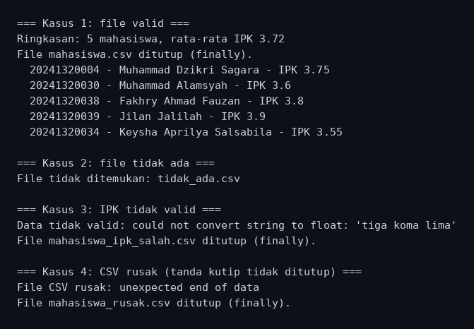
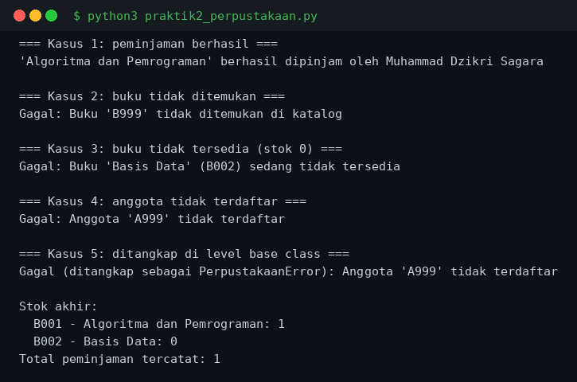
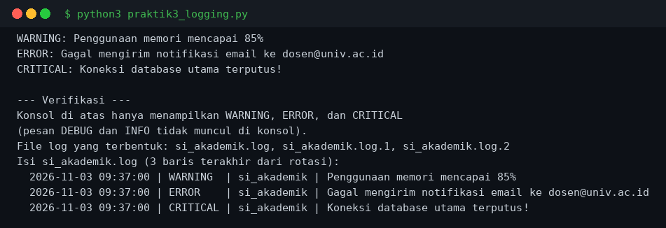
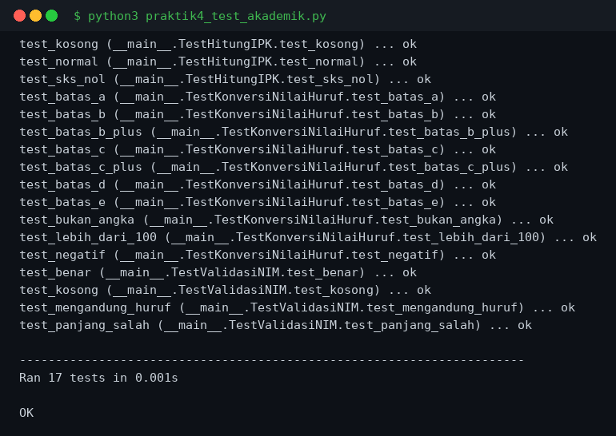
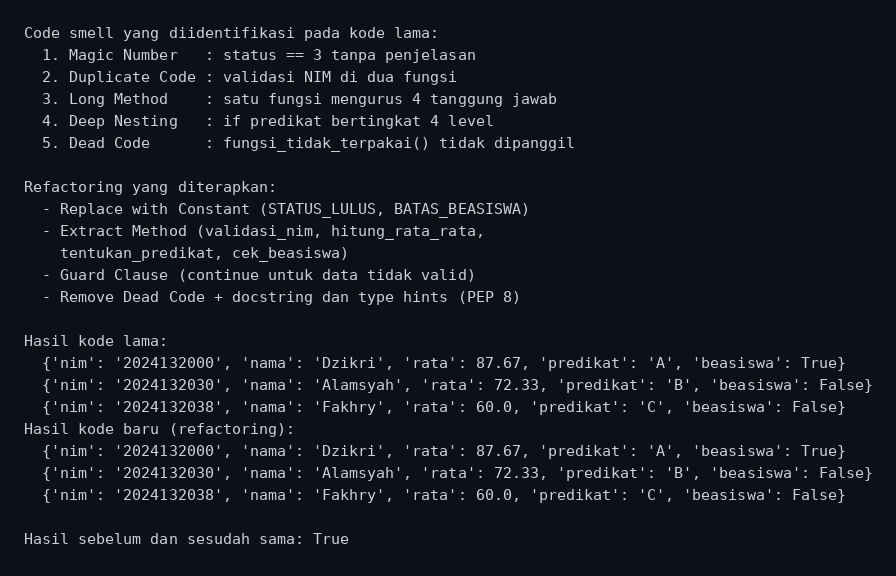
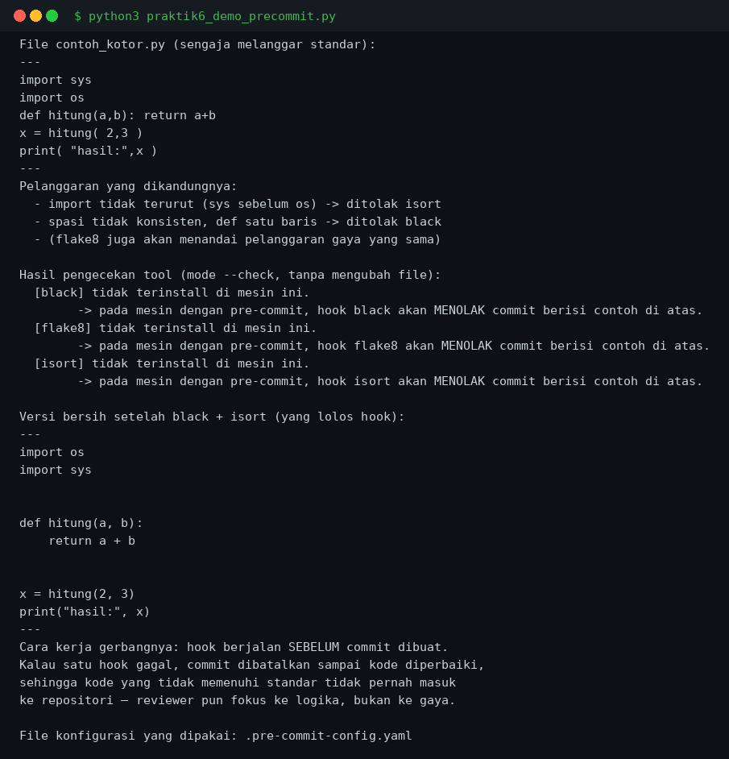

# Python Task 7 — Exception Handling, Debugging, Logging, Unit Testing, Clean Code & Code Review

## Identitas

| | |
|---|---|
| Nama | Muhammad Dzikri Sagara |
| NPM | 20241320004 |
| Program Studi | Sistem Informasi A1 |
| Mata Kuliah | Pemrograman Python — Pertemuan 7 |
| Modul | Modul Bahan Ajar Python: Exception Handling, Debugging, Logging, Unit Testing, Clean Code, dan Code Review |

## Deskripsi

Repositori ini berisi penyelesaian **Latihan Soal Pertemuan 7** dari modul bahan ajar
Pemrograman Python. Modul ini membahas cara menulis program yang robust dan mudah
dirawat: penanganan exception (`try-except-else-finally`, custom exception),
debugging (print vs `pdb`), logging (level, handler, formatter, rotasi),
unit testing (`unittest`), clean code (PEP 8, DRY, code smell, refactoring),
dan code review (checklist, static analysis, pre-commit hooks).

Soal teori dijawab pada [`soal_teori.md`](soal_teori.md), sedangkan enam soal praktik
diimplementasikan sebagai program Python yang semuanya sudah dijalankan dan hasilnya
diverifikasi:

| Soal | Program | Konsep Utama | Ringkasan |
|---|---|---|---|
| Praktik 1 | `praktik1_csv_mahasiswa.py` | `try-except-else-finally` | Baca CSV mahasiswa: FileNotFoundError, csv.Error, ValueError, finally, else |
| Praktik 2 | `praktik2_perpustakaan.py` | Hierarki custom exception | PerpustakaanError, BukuNotFoundError, BukuTidakTersediaError, AnggotaNotFoundError |
| Praktik 3 | `praktik3_logging.py` | RotatingFileHandler, level, formatter | Log DEBUG ke file (rotasi), WARNING ke konsol |
| Praktik 4 | `praktik4_test_akademik.py` | `unittest`, setUp, assertRaises | 17 test untuk hitung_ipk, validasi_nim, konversi_nilai_huruf |
| Praktik 5 | `praktik5_refactoring.py` | Code smell, guard clause, type hints | Sebelum vs sesudah refactoring, hasil dijamin sama |
| Praktik 6 | `praktik6_demo_precommit.py` + `.pre-commit-config.yaml` | Pre-commit hooks | black, flake8, isort sebagai gerbang commit |

## Cara Menjalankan

```bash
python3 praktik1_csv_mahasiswa.py
python3 praktik2_perpustakaan.py
python3 praktik3_logging.py
python3 praktik4_test_akademik.py
python3 praktik5_refactoring.py
python3 praktik6_demo_precommit.py
```

Tidak ada dependensi eksternal. Program praktik 6 mendeteksi sendiri apakah
`black`, `flake8`, dan `isort` terinstall di mesin; kalau tidak ada, demo tetap
menjelaskan apa yang akan ditolak oleh hook.

## Hasil Eksekusi

Screenshot di bawah ini adalah hasil eksekusi program yang sesungguhnya. Output
terminal yang sama juga tersimpan sebagai teks di folder `outputs/`.

### Praktik 1 — Baca CSV Mahasiswa



### Praktik 2 — Custom Exception Perpustakaan



### Praktik 3 — Logging SI Akademik



### Praktik 4 — Unit Test Akademik



### Praktik 5 — Refactoring Code Smell



### Praktik 6 — Demo Pre-commit Hooks


